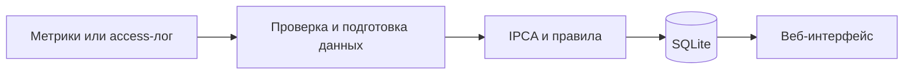

# Сервис мониторинга приложений

**Python · NumPy · SQLite · HTTP API · JavaScript**

Локальное приложение для наблюдения за числовыми показателями и журналами
веб-приложений. Сохраняет историю, рассчитывает отклонения от обычной работы
и показывает предупреждения в браузере.

## Что можно посмотреть

- **Мониторинг:** системные показатели компьютера и данные через HTTP API.
- **Журналы:** построчное чтение access-лога, количество запросов, время ответа, доля ошибок.
- **Обнаружение:** IPCA на NumPy и правила по качеству ответов; отдельные состояния обучения, тревоги и восстановления.
- **Хранение:** SQLite, восстановление состояния после перезапуска.
- **Интерфейс:** графики, история и встроенное учебное приложение для демонстрации.



## Быстрый запуск

Python 3.10 или новее. В PowerShell из папки проекта:

```powershell
py -3 -m venv .venv
.\.venv\Scripts\python.exe -m pip install -r requirements.txt
.\.venv\Scripts\python.exe -m monitor_service --data-dir runtime-data
```

Открыть **http://127.0.0.1:8765**. Для остановки нажать `Ctrl+C`.
На Linux: `python3 -m venv .venv`, затем использовать `.venv/bin/python`.

### Первая демонстрация

1. Нажать **«Демонстрационный поток»** в интерфейсе.
2. Выбрать созданный источник и наблюдать за графиками и состоянием обучения.
3. Демонстрация ускоренно подаёт искусственные наблюдения; после начального
   обучения появятся рассчитанные оценки и предупреждения.

Для настоящего источника с одним наблюдением в секунду начальное обучение
занимает около 15 минут. Ускоренная демонстрация нужна для знакомства с интерфейсом.

Для проверки отдельного приложения есть встроенный стенд. Подробности:
[как устроен сервис](docs/ARCHITECTURE.md) и [HTTP API](docs/API.md).

## Проверки

```powershell
.\.venv\Scripts\python.exe -m unittest discover -s tests -v
.\.venv\Scripts\python.exe -m unittest monitor_service.test_log_parser monitor_service.test_log_aggregation monitor_service.test_log_tailer monitor_service.test_log_ingest
```

Проверяются HTTP API, SQLite, отказ от некорректных данных, парсер,
агрегатор, чтение растущего файла и восстановление после перезапуска.
Полный исследовательский архив для этих команд не нужен.
[Отчёт о проверке публичной копии](docs/VERIFICATION.md).

## Основные файлы

| Файл | Назначение |
|---|---|
| `monitor_service/__main__.py` | Запуск и параметры командной строки |
| `monitor_service/server.py` | HTTP API и раздача интерфейса |
| `monitor_service/store.py` | Проверка входных данных и SQLite |
| `monitor_service/detector.py`, `immediate.py` | Оценка отклонений и обновление модели |
| `monitor_service/log_*.py` | Чтение, разбор и обработка журналов |
| `monitor_service/static/` | Интерфейс на HTML, CSS и JavaScript |

## Статус и границы

Дипломный прототип. Работает на локальном адресе; публичное размещение без
доработки доступа не предусмотрено. Сигнал означает отклонение, а не доказанную
причину аварии. Поддерживаются заданные форматы журналов.

Репозиторий содержит программную часть. Закрытые записи, рабочие базы,
служебные отчёты и сценарии длительных исследовательских серий сюда не входят.
Преимущество IPCA над простыми правилами для любых данных не заявляется.

[Другие проекты автора](https://github.com/davessii)
